# Проверка селфи водителя в Яндекс Про

Я выбрала Яндекс и один процесс в Яндекс Про — проверку селфи водителя такси для доступа к заказам. По инструкции Яндекс Про водитель открывает «Фотоконтроль» и делает селфи. Алгоритм сравнивает снимок с предыдущими селфи. Если фото совпало, можно вернуться к заказам. Если фото не подошло, его нужно переснять. [Инструкция Яндекс Про «Проверка селфи»](https://pro.yandex.ru/ru-ru/ocher/knowledge-base/taxi/safety/identification)

На BPMN я начала с запроса на проверку в приложении. Дальше показала отправку фото, вызов модели, пересъёмку и ручную проверку. Процесс заканчивается, когда водитель получает доступ к заказам или прекращает попытки. Проверку документов и автомобиля, причины назначения фотоконтроля и распределение заказов я оставила за рамками. На C4 показала, откуда сервис берёт признаки лица и новые версии модели.

## Что делает модель

На вход сервис получает новое селфи и векторы признаков из предыдущих подтверждённых селфи. Он оценивает качество снимка, наличие живого лица и сходство с эталоном. Сервис возвращает оценки, версию модели и код причины в Verification Orchestrator. По этому ответу оркестратор открывает доступ, просит переснять фото или передаёт случай специалисту.

Водитель видит итог в приложении, а платформа заказов получает решение о доступе. Специалист получает только назначенные ему случаи. Цель проверки — убедиться, что за рулём тот же человек, который пользуется аккаунтом.

## Допущения

- Я предположила, что проверка даёт три отдельные оценки, а эталон для модели хранится в виде заранее рассчитанных векторов лица.
- Я задала свои пороги и таймаут. Пограничные случаи и сбои сервиса отправляются специалисту. Если он подтверждает совпадение, доступ открывается. Иначе водитель получает запрос на пересъёмку. Водитель может прекратить попытки, тогда доступ остаётся закрытым.
- Сервисы, хранилища, очередь и технологии на C4 я выбрала для этой схемы. Платформу заказов и сервис уведомлений вынесла за границу системы проверки.
- Model Registry хранит версии, прошедшие проверку на отложенной выборке. ML Inference Service загружает одобренную версию. В технические логи пишутся оценки и время ответа без исходного фото.
- Решение специалиста используется как разметка для следующего обучения. Обычные исходы нужны для наблюдения за работой модели.

## Как система принимает решение

1. Если сервис модели недоступен или не ответил за 3 секунды, случай уходит на ручную проверку.
2. Если качество ниже 0,80 или оценка живости ниже 0,85, водителя просят переснять фото.
3. Если обе оценки прошли пороги и сходство от 0,82, доступ открывается автоматически.
4. Если обе оценки прошли пороги, а сходство от 0,65 до 0,82, не включая верхнюю границу, фото проверяет специалист.
5. Если обе оценки прошли пороги, а сходство ниже 0,65, водитель переснимает фото.

После ручной проверки сохраняется отметка «совпало» или «не совпало» и причина. Training Pipeline берёт эту разметку для следующего обучения и проверяет новую версию перед публикацией в Model Registry. По автоматическим проверкам можно отслеживать время ответа, долю пересъёмок и ручных проверок. Само решение модели не используется как метка совпадения.

## Схемы

Файлы `.mmd` можно открыть в [Mermaid Live Editor](https://mermaid.live/). SVG и PNG открываются в браузере.

| Схема | Исходник | Изображения |
|---|---|---|
| BPMN — шаги проверки | [Mermaid](diagrams/bpmn.mmd) | [SVG](diagrams/bpmn.svg) · [PNG](diagrams/bpmn.png) |
| C4 Context — люди и внешние системы | [Mermaid](diagrams/c4-context.mmd) | [SVG](diagrams/c4-context.svg) · [PNG](diagrams/c4-context.png) |
| C4 Containers — сервисы и хранилища | [Mermaid](diagrams/c4-containers.mmd) | [SVG](diagrams/c4-containers.svg) · [PNG](diagrams/c4-containers.png) |
| C4 Components — ML Inference Service | [Mermaid](diagrams/c4-ml-components.mmd) | [SVG](diagrams/c4-ml-components.svg) · [PNG](diagrams/c4-ml-components.png) |

### BPMN

### C4 Context

### C4 Containers

### C4 Components

## Как связаны BPMN и C4

| Шаг на BPMN | Где он выполняется на C4 |
|---|---|
| Создать сессию проверки | Backend Яндекс Про передаёт запрос в Verification Orchestrator |
| Получить эталонные признаки предыдущих селфи | Verification Orchestrator читает векторы из Profile & Reference Store |
| Вызвать ML Inference Service | ML Inference Service получает фото и векторы и возвращает оценки в Verification Orchestrator |
| Поставить случай в очередь ручной проверки | Verification Orchestrator отправляет случай в Review Queue, откуда он попадает в Review Console |
| Открыть доступ к заказам | Verification Orchestrator передаёт решение платформе заказов |
| Сохранить решение как разметку | Review Console отправляет отметку и причину в Outcome & Label Store |

## Источники

Продуктовый сценарий взяла из инструкции Яндекс Про. Схемы сервисов и правила обработки ответа модели составила сама. Для обозначений сверялась с примерами Camunda и описанием C4.

- [Яндекс Про — «Проверка селфи»](https://pro.yandex.ru/ru-ru/ocher/knowledge-base/taxi/safety/identification)
- [Camunda — примеры BPMN](https://camunda.com/bpmn/examples/)
- [C4 model](https://c4model.com/)
